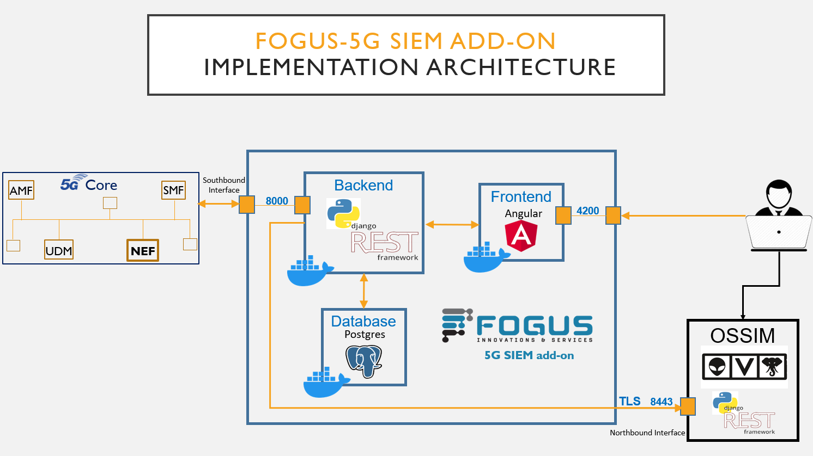

# FOGUS-5G-SIEM-add-on
An application developed by [Fogus Innovations & Services](https://fogus.gr/) for connecting 5G devices with a Security Information and Event Management (SIEM) system.

<!-- TABLE OF CONTENTS -->
<details>
  <summary>Table of Contents</summary>
  <ol>
    <li><a href="#about-the-project">About The Project</a></li>
    <li><a href="#installations">Installations</a></li>
    <li><a href="#setup">Setup</a></li>
    <li><a href="#license">License</a></li>
  </ol>
</details>

<!-- Body -->

## About The Project
The [FOGUS-5G SIEM add-on](https://github.com/fogusinnovations/FOGUS-5G-SIEM-add-on) is a standalone application which is developed as a separate software component (a containerized  application exposing a set of REST API endpoints) communicating with a SIEM application and a 5G NPN (by calling the exposed NEF APIs).
Indicative capabilities of the FOGUS-5G SIEM add-on:

• Receives data from 5G network

• Converts the collected data/logs/events from 5G network, to readable format for the SIEM

• Sends formatted data to SIEM over Https protocol


The [FOGUS-5G SIEM add-on](https://github.com/fogusinnovations/FOGUS-5G-SIEM-add-on) has been tested with the [AlienVault OSSIM](https://cybersecurity.att.com/products/ossim).


<br/>

## Installations

### Install [Docker](https://docs.docker.com/get-docker/)

### Install [Make](https://www.gnu.org/software/make/)

### Install [Docker Compose](https://docs.docker.com/compose/)

### Install CAPIF

Follow the instructions at: https://github.com/fogusinnovations/FOGUS-CAPIF-Services

### Install NEF Emulator

Follow the instructions at: https://github.com/medianetlab/NEF_emulator

### Install EVOLVED-5G CLI & SDK

Follow the instructions at: https://github.com/EVOLVED-5G/SDK-CLI

### Install jq (optional)

```bash
sudo apt install -y jq
```

## Setup

### Deploy FOGUS App 
```bash
git clone https://github.com/fogusinnovations/FOGUS-5G-SIEM-add-on.git
```
```bash
cd FOGUS-5G-SIEM-add-on/src
```

### Configure environmental variables 
Edit [env_to_copy.dev](./env_to_copy.dev)

#### Build and deploy containers
```bash
make (run) 
```

#### Stop and deploy again the containers
```bash
make restart
```

#### Remove and deploy again the containers
```bash
make fresh
```

#### Stop containers
```bash
make stop
```

#### Stop and remove containers
```bash
make clean
```

### Architecture

| Container             | Folder                | Description                                      |
|-----------------------|-----------------------|--------------------------------------------------|
| app_backend_django    | app_backend           | Backend of FOGUS App                             |
| app_frontend_angular  | app_frontend          | Frontend of FOGUS App                            |
| app_postgres          | -                     | DB to store the data                             | 


### Access FOGUS App
#### In your browser, access the following url for the UI (frontend)
```
http://localhost:4200/
```

#### In your browser, access the following url for the UI of Django (backend)
```
http://localhost:8000/
```

## License

This project is licensed under the Apache License - see the [LICENSE.md](https://github.com/fogusinnovations/FOGUS-5G-SIEM-add-on/blob/main/LICENSE) file for details
